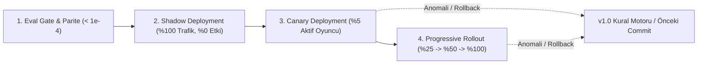

# Sürüm Notları, Güvenli Dağıtım ve Mimari Ödünleşim Belgesi (`RELEASE.md`)

---

## 1. `v2.0.0` Sürüm Özeti: `v1.0` → `v2.0` Geçişinde Ne Değişti?

| Bileşen | `v1.0` (Sabit Kural Motoru) | `v2.0` (Davranışsal ONNX Modeli) |
| :--- | :--- | :--- |
| **Uyarlama Mekanizması** | Girişteki 3 soruya bağlı statik `if/else` dallanması (`deneyim_seviyesi == 1` ise ipucu aç). | Oyuncunun sahne içi 7 davranışsal özelliğini (`karar_suresi_sn`, `secenek_degistirme_sayisi`, `onceki_kritik_hata_sayisi`, `mimari_risk_skoru` vb.) değerlendiren `StandardScaler → LogisticRegression` ONNX modeli (`model.onnx`). |
| **Oyun Davranışı Etkisi** | Yalnızca sabit metin gösterimi. | `P(mudahale_gerekli=1) >= 0.55` olduğunda: (1) Sokratik Mentor kartı açılır, (2) Anlatım derinliği (*Mimari Ödünleşim Analizi*) genişler, (3) Riskli şıklarda uyarı rozeti belirir, (4) Hata cezası `%40` yumuşatılır. |
| **Doğrulama & Parite** | Yalnızca UI akış testi. | Eğitim öncesi tanımlı **Eval Kapısı** (`AUC >= 0.80`, `Accuracy >= 0.78`) + **Diferansiyel Parite Testi** (Python Oracle vs. Web `onnxruntime-web` ve Sunucu API arasında `< 1e-4` hata toleransı). |

---

## 2. Commit'e Sabitlenmiş Sürümleme (Immutable Artifact Pinning) ve Rollback Planı

### Neden `main` Dalı Değil Commit SHA?
Üretimdeki tüketiciler (Web ve Mobil istemciler) model artefaktını asla hareketli `main` dalından (`/resolve/main/model.onnx`) çekmez. `main` dalına yapılacak hatalı bir yükleme tüm istemcileri anında bozabilir (Shankar vd., 2022 — *Versioning*). Bunun yerine her sürüm **değişmez (immutable) bir Git/HF commit özetine (SHA)** sabitlenir:

```text
https://huggingface.co/Seymen55/the-primer-v2-onnx/resolve/846390dc7ad50af1e942307346bfd0e8e93824a2/model.onnx
https://huggingface.co/Seymen55/the-primer-v2-onnx/resolve/846390dc7ad50af1e942307346bfd0e8e93824a2/config.json
```

### Acil Geri Alma (Rollback) Planı
Üretimde beklenmedik bir dağılım kayması (*data drift*), istemci bellek hatası veya parite sapması tespit edildiğinde **2 kademeli Rollback** uygulanır:

1. **Kademe 1 — Model Commit Rollback (< 60 saniye):**
   `web/site.json` içindeki `commit` ve `pinned_model_url` alanları bir önceki doğrulanmış commit SHA değerine döndürülür (`git revert HEAD && git push`). Model ağırlıkları ve `config.json` sözleşmesi birlikte versiyonlandığı için şema uyumsuzluğu yaşanmaz.
2. **Kademe 2 — Kural Tabanlı `v1.0` Emniyet Kemerine Dönüş (Kill-Switch):**
   Eğer uzak model sunucusuna (Hugging Face CDN) erişilemezse veya ONNX oturumu başlatılamazsa, istemci otomatik olarak yerel `web/model/model.onnx` kopyasına, o da başarısız olursa `v1.0` deterministik kural motoruna (`seviye == 1 || kritik_hata >= 2`) sessizce geri döner (*Graceful Degradation*).

---

## 3. Yeni Sürümü Güvenle Devreye Alma: Shadow → Canary → Progressive Rollout

Yeni eğitilen bir model Eval Kapısını (`train.py`) ve Diferansiyel Parite Testini (`tests/parite.py`) geçse bile doğrudan tüm oyunculara `%100` açılmaz (Amershi vd., 2019; Breck vd., 2017):



1. **Aşama 1 — Shadow Deployment (Gölge Dağıtım — 48 Saat):**
   - Oyunculara ekranda hâlâ `v1.0` sabit kural motorunun kararları uygulanır.
   - Arka planda `v2.0` ONNX modeli (`model.onnx`) her sahnede sessizce çalıştırılır ve `[Shadow Mode] v1 Kuralı vs. v2 ONNX Kararı` karşılaştırması kaydedilir (uygulamamızda `data-cy="shadow-log"` panelinde canlı gösterilmektedir).
   - **Geçiş Kriteri:** Çıkarım gecikmesinin `< 15 ms` olması, `NaN/Infinity` olasılık üretilmemesi ve `v2` müdahale oranının `%25 – %65` bandında kalması.
2. **Aşama 2 — Canary Deployment (Kanarya Dağıtımı — `%5` Trafik):**
   - Rastgele üretilen `oturum_id` özetinin son baytına göre (`hash(oturum_id) % 100 < 5`) oyuncuların yalnızca **`%5`'ine** `v2.0` ONNX modelinin Sokratik müdahale kararları gerçekten uygulanır.
   - **İzlenen Metrik:** Kanarya grubundaki oyuncuların sonraki sahnelerde yaptığı kritik hata oranının (`onceki_kritik_hata_sayisi`) kontrol grubuna göre azalması ve oturumu tamamlama oranı.
3. **Aşama 3 — Progressive Rollout (Aşamalı Geçiş — `%25 → %50 → %100`):**
   - Kanarya aşamasında regresyon veya hata görülmezse trafik sırasıyla `%25`, `%50` ve `%100` seviyesine çıkarılır. Her kademede hata bütçesi (*error budget*) aşılırsa otomatik Rollback tetiklenir.

---

## 4. Mimari Dağıtım Kararı ve Ödünleşim (Trade-off / Feragat) Matrisi

Başlangıç reposunda (`huggingface-hello-web`) gösterilen üç farklı çıkarım mimarisini (**Tarayıcı `onnxruntime-web`**, **Cihaz İçi Mobil `React Native / Expo`**, **Kendi Sunucumuz `Rails API / Python ONNX Server`**) derste tartışılan **3 temel mühendislik sorusu** üzerinden değerlendirdik:

| Değerlendirme Boyutu | 1. Tarayıcı İstemcisi (`onnxruntime-web` — GitHub Pages) | 2. Cihaz İçi Mobil (`React Native / Expo` Gömülü ONNX) | 3. Kendi Sunucumuz (`server/app.py` / `Rails API` — Render.com) |
| :--- | :--- | :--- | :--- |
| **Soru 1: İnternet/ağ zorunlu mu ve gecikme (latency) nasıl davranır?** | **İlk açılışta internet zorunludur:** Sayfa ve `model.onnx` (~2 KB) indirilirken tek seferlik soğuk başlangıç (*cold start*) gecikmesi (~50–150 ms) yaşanır. Sonraki tüm sahne kararlarında çıkarım yerel WASM içinde **`< 1 ms`** sıfır ağ gecikmesiyle çalışır. | **İnternet zorunlu değildir (Tam Çevrimdışı):** Model APK/uygulama paketine gömülüdür (`assets/model/model.onnx`). İlk açılışta ağ beklemesi yoktur; her sahnede cihaz içi CPU/NPU üzerinde **`< 1 ms`** deterministik gecikmeyle çalışır. | **Her kararda internet zorunludur:** Her sahne geçişinde `POST /api/v1/predictions` isteği atılır. Ağ gecikmesi (*RTT*: ~30–200 ms) ve ücretsiz bulut katmanlarında (Render.com) uyku modundan uyanma (*cold start*: ~10–30 sn) riski vardır. |
| **Soru 2: Veri cihazdan çıkar mı? (Gizlilik ve KVKK)** | **Hayır, veri cihazdan çıkmaz:** Oyuncunun karar süresi, tereddüt sayısı ve hata örüntüsü tarayıcı belleğinde kalır; hiçbir sunucuya gönderilmez. KVKK açısından **en yüksek gizlilik** düzeyini sağlar. | **Hayır, veri cihazdan çıkmaz:** Gömülü modda tüm davranışsal telemetri telefonun kendi belleğinde işlenir. KVKK ve veri minimizasyonu açısından tam yerel gizlilik sunar. | **Evet, veri cihazdan çıkar:** Oyuncunun 7 davranışsal özelliği JSON gövdesiyle ağ üzerinden sunucuya iletilir. Bu nedenle HTTPS zorunludur ve sunucu loglarında `inputs` alanları filtrelenmelidir (`server/app.py` içinde uygulanmıştır). |
| **Soru 3: Model gizli kalır mı? (Fikri Mülkiyet & Tersine Mühendislik / REA)** | **Hayır, model tamamen açıktır:** `model.onnx` ve `config.json` tarayıcı Ağ (Network) sekmesinden doğrudan indirilebilir; Netron veya REA araçlarıyla tüm katman ve ağırlıklar incelenebilir. | **Hayır, model gizli kalmaz:** APK dosyası `apktool` veya REA (`inspect_android_package`) ile açıldığında `assets/` içindeki `model.onnx` doğrudan çıkarılabilir. | **Evet, model dosyası gizli kalır:** `model.onnx` sunucu diskinde/özel S3'te durur; istemci yalnızca olasılık yanıtını görür. *(Ancak saldırgan çok sayıda sorgu atarak **Model Extraction / Black-Box Tersine Mühendislik** denemesi yapabilir; hız sınırlama/rate-limit gerekir).* |

### The Primer v2 İçin Seçilen Mimari Karar ve Gerekçesi
- **Birincil Çalışma Ortamı:** **Tarayıcı İstemcisi (`onnxruntime-web`)** + **Yedek/Bonus Sunucu (`server/app.py`)**.
- **Mühendislik Gerekçesi:**
  1. Modelimiz hasta verisi veya ticari sır içermez; pedagojik bir Sokratik mentor modelidir. Bu nedenle `model.onnx` dosyasının istemciye açık olması bir güvenlik zafiyeti oluşturmaz.
  2. Buna karşılık, oyuncunun her seçenek değiştirdiğinde (`secenek_degistirme_sayisi`) modelin **anlık (`< 1 ms`) tepki vermesi** ve oyuncu davranış verisinin **KVKK gereği cihaz dışına çıkmaması** kritik önemdedir.
  3. Ayrıca sunucu tarafı parite doğrulaması için `server/app.py` (+10 bonus tüketici) aynı `model.onnx` artefaktını çalıştıracak şekilde repoya eklenmiş ve 5 referans girdide `< 1e-4` toleransla birebir aynı sonucu verdiği kanıtlanmıştır.

---

## 5. Akademik ve Endüstriyel Referanslar

1. **Amershi, S. vd. (2019).** *Software Engineering for Machine Learning: A Case Study.* IEEE/ACM ICSE-SEIP. (Yaşayan ML yaşam döngüsü ve model-veri bağımlılığı).
2. **Shankar, S. vd. (2022).** *Operationalizing Machine Learning: An Interview Study.* (Üretimde ML sistemlerinin 3V problemi: *Velocity*, *Validation*, *Versioning*).
3. **Mitchell, M. vd. (2019).** *Model Cards for Model Reporting.* ACM FAT*. (`model/README.md` şeffaflık ve sınır raporlaması).
4. **Breck, E. vd. (2017).** *The ML Test Score: A Rubric for ML Production Readiness and Technical Debt Reduction.* IEEE Big Data. (Eğitim-çıkarım sapması / *Training-Serving Skew* ve diferansiyel parite testleri).
5. **Sommerville, I. (2015).** *Software Engineering* (10th ed.). Pearson. (Bl. 8 Doğrulama ve Geçerleme / V&V, Regresyon Testi; Bl. 25 Konfigürasyon ve Sürüm Yönetimi).
6. **Stanford HAI (2025) & Gartner (2025).** *AI Index Report & Small Task-Specific Models Forecast.* (Çıkarım maliyetlerindeki 300x düşüş ve dikey küçük modellerin yükselişi).
